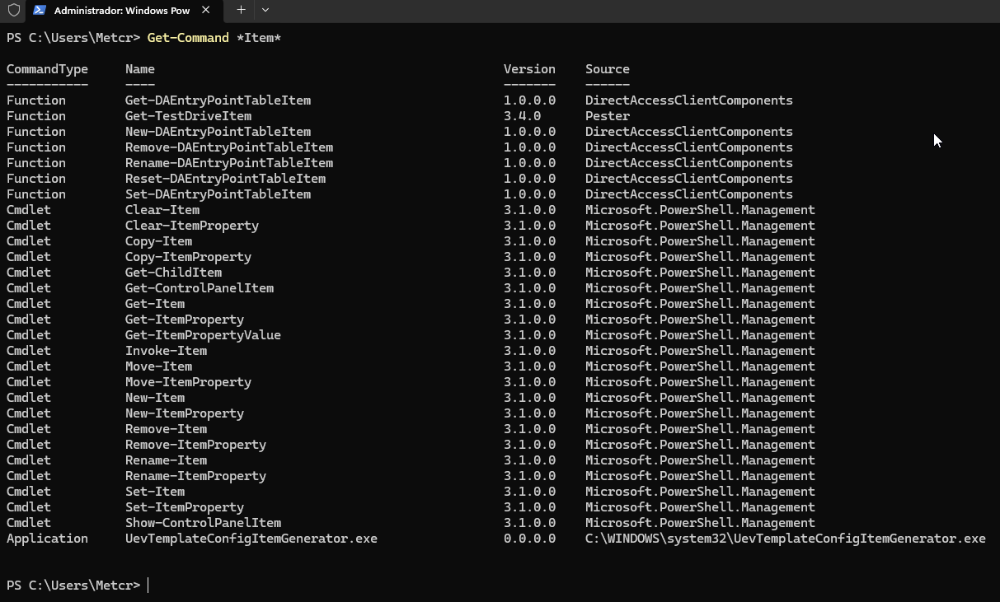
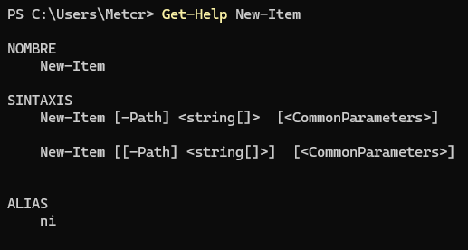
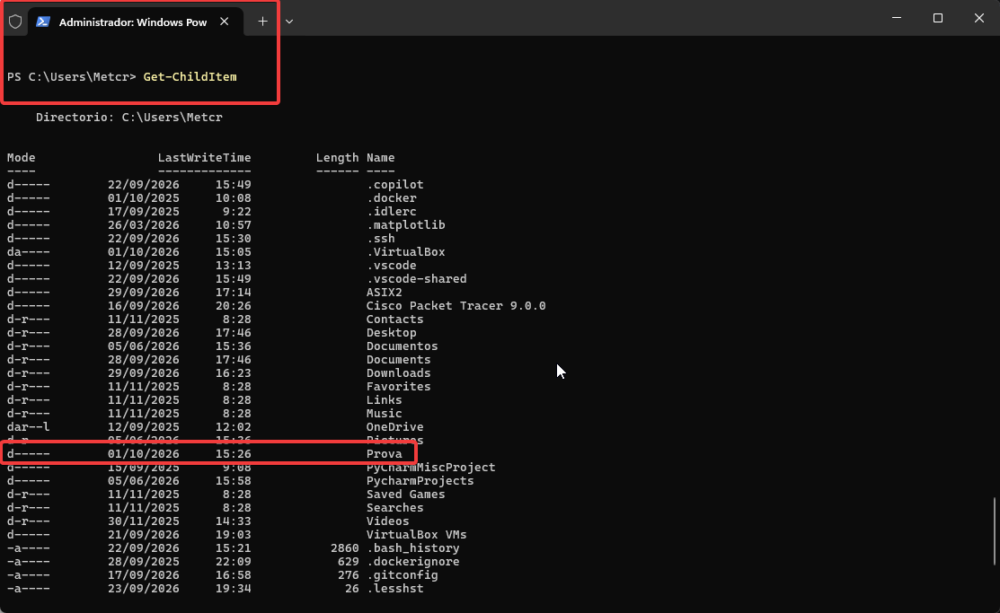
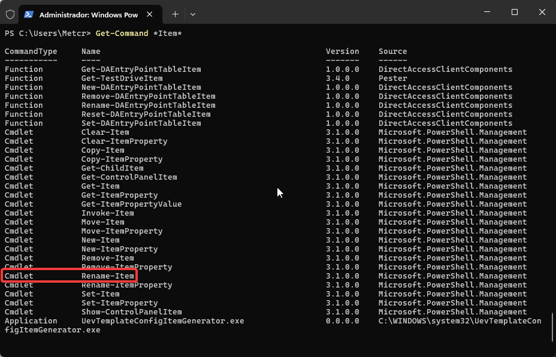
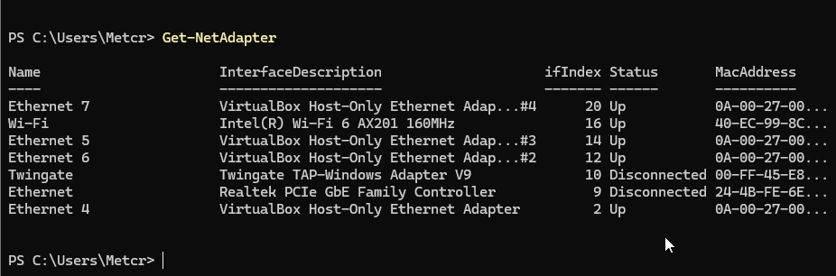
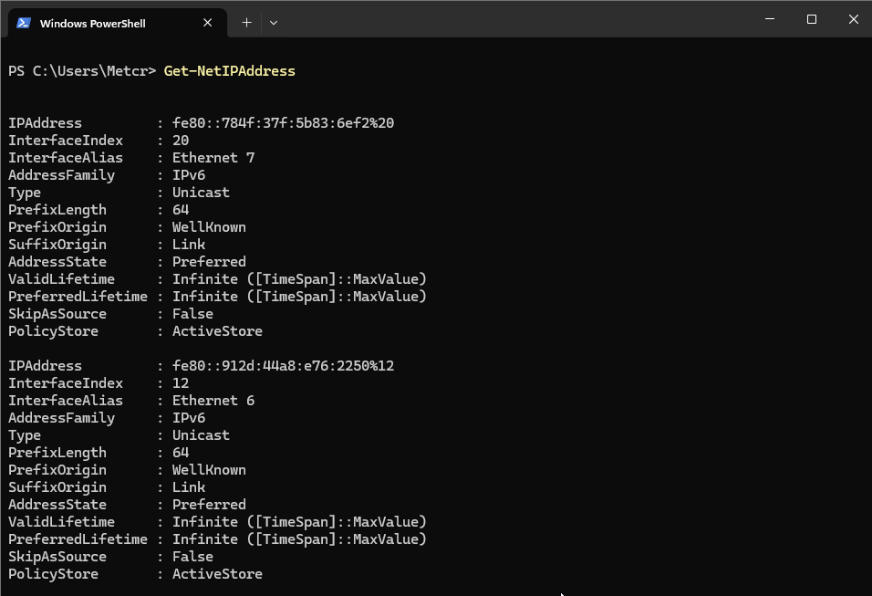
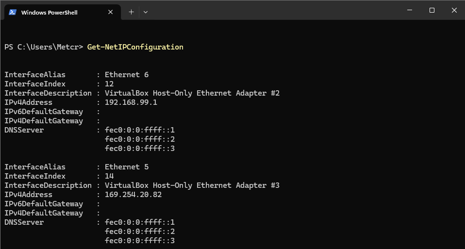
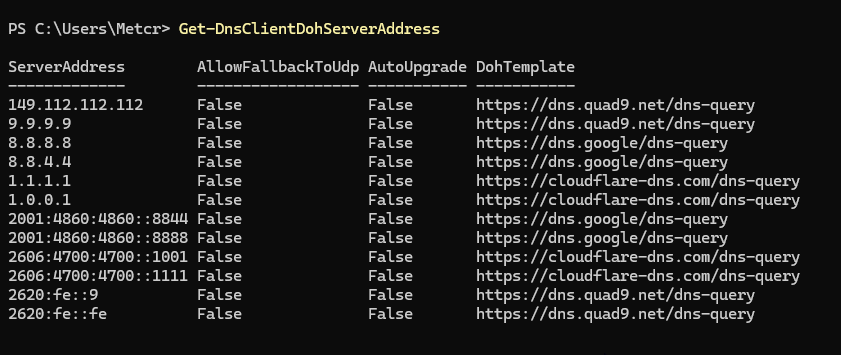
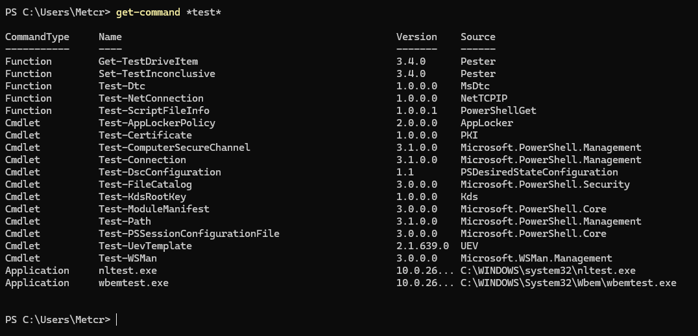
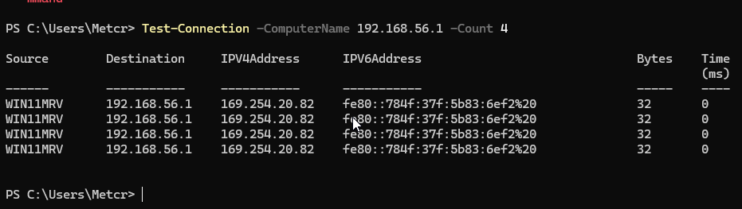

> **Nota**: Els exercicis/pràctiques t'han de servir per a familiarizar-te amb el llenguatge Powershell. Aprofita per a realitzar diverses proves i veure què passa. Documenta també aquestes proves i resultats.

# Treballar amb fitxers i carpetes

**Situació:** encara no hem estudiat les ordres de PowerShell per treballar amb fitxers i carpetes. Les haurem de descobrir utilitzant les eines d'ajuda de PowerShell.

**1. Buscar ordres**

Busca cmdlets que continguin la paraula `Item`:

```
Get-Command *Item*
```



Observa les ordres que apareixen.

Intenta identificar quina ordre podria servir per:

- crear un element;

  **New-item**

- eliminar un element;

  **Remove-Item**

- canviar el nom d'un element;

  **Rename-Item**

- copiar un element;

  **Copy-Item**

- moure un element.
  **Move-Item**
  
---

**2. Investigar una ordre**

Sense executar-la encara, consulta què fa:

```
Get-Help New-Item
```



Respon:

- Per a què serveix `New-Item`?

  Per crear coses com per exemple carpetes

- Quina estructura té l'ordre?

  New-Item [-Path] <string[]> [(<)CommonParameters(>)]

Consulta alguns exemples:

```
Get-Help New-Item -Examples
```


**3. Descobrir un paràmetre**

Consulta què significa el paràmetre `-ItemType`:

```
Get-Help New-Item -Parameter ItemType
```


A partir de l'ajuda, intenta descobrir com crear una carpeta.

Per exemple, haurien d'arribar a alguna cosa semblant a:

```
New-Item -ItemType Directory -Name Prova
```




---

**4. Nou repte**

Ara necessites saber com **canviar el nom de la carpeta**, però no coneixes l'ordre.

Utilitza:

```
Get-Command *Item*
```

i després consulta l'ajuda de l'ordre que creguis adequada.

L'objectiu és arribar a descobrir:

```
Rename-Item
```



i consultar:

```
Get-Help Rename-Item -Examples
```


Sense utilitzar Internet, descobreix quins cmdlets faries servir per:

Eh utilitzat Get-Command _Item_ per descobrir els cmdlets i despres eh utilitzat el get-help (el cmdlets que vull consultar) -exemples.

1. crear una carpeta;

   **New-Item -ItemType Directory -Name Prova**

2. canviar-li el nom;

   _Si no estas en el lloc on esta l'item posa la ruta completa._

   **Rename-Item -Path "Prova" -NewName "Prova2"**

3. copiar-la;

   **Copy-Item -Path "Prova2" -Destination "C:\Copies\Prova2"**

4. moure-la;

   **Move-Item -Path "Prova2" -Destination "C:\Copies\Prova2"**

5. eliminar-la.

   **Remove-Item -Path "Prova2"**

**Condició:** només pots utilitzar `Get-Command` i `Get-Help` per investigar les ordres.

Descobrir ordres de xarxa amb PowerShell

## Situació

Estàs administrant un servidor Windows i necessites consultar informació de la seva configuració de xarxa.

Encara no coneixes les ordres de PowerShell relacionades amb xarxa.

La teva feina és descobrir-les utilitzant principalment:

```
Get-Command
Get-Help
```

No pots buscar les respostes a Internet.

---

## Tasques

Descobreix quines ordres de PowerShell et permeten obtenir la informació següent:

1. Mostrar els adaptadors de xarxa de l’equip.

   **Cmdlet trobat: Get-NetAdapter**

   Com l’he localitzat amb Get-Command:

Primer he buscat les ordres relacionades amb els adaptadors de xarxa. He escrit NetAdapter, que és adaptador de xarxa en anglès. Si escric net, també acaba sortint, ja que, si la paraula està inclosa, ho mostrarà.




2. Consultar les adreces IP configurades.

   **Cmdlet: Get-NetIPAddress**

   Com l’he trobat: He escrit Get-Command ipaddress adreça ip en anglès, Aquest cmdlet mostra la configuracio i les ips configurades.



3. Consultar la configuració IP completa dels adaptadors de xarxa.

   **Cmdlet: Get-NetIPConfiguration**

   Com l’he trobat: He escrit Get-Command ipconfiguration. aquest cmdlet mostra la configuracio completa de les targete de xarxa que tenim guardades al nostre PC.



4. Consultar els servidors DNS configurats.

   **Cmdlet: Get-DnsClientDohServerAddress**

   Com l’he trobat: He escrit Get-Command dns, aquesta comanda mostra la adreça dels servidors DNS que tenim en el nostre PC.



5. Comprovar si hi ha connectivitat amb un altre equip de la xarxa.

   **Cmdlet: Get-TestConnection**

   Com l’he trobat: He escrit Get-Command test.



**Posem per exemple la ip del router per povar la cmdlet amb 4 intents.**

## 

## Per cada tasca

Indica:

- el cmdlet que has trobat;
- com l’has localitzat amb `Get-Command`;
- una breu explicació del que fa;
- la comanda que has executat;
- el resultat obtingut.

L'objectiu és que hi hagi una traçabilitat de com s'ha arribat a la comanda final.
