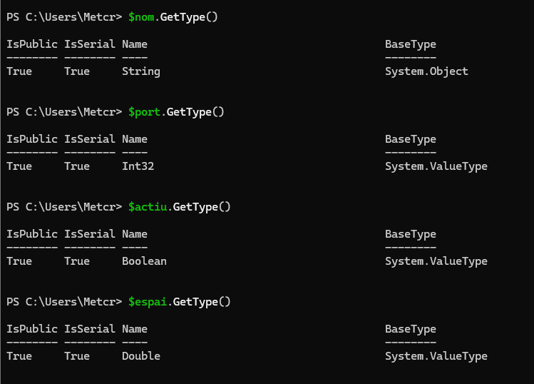
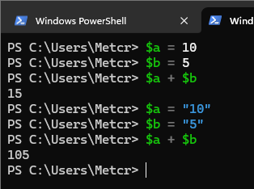
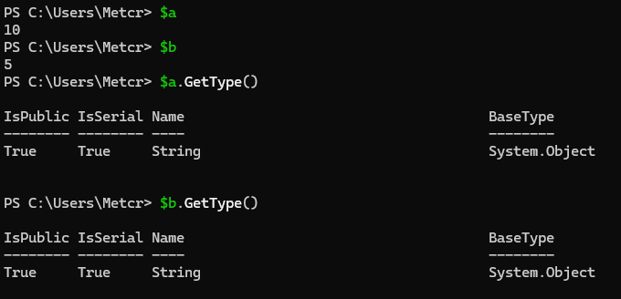
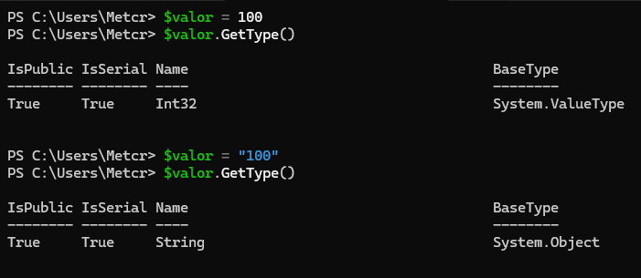
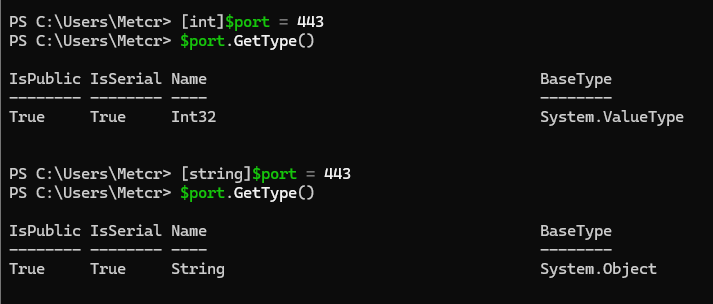
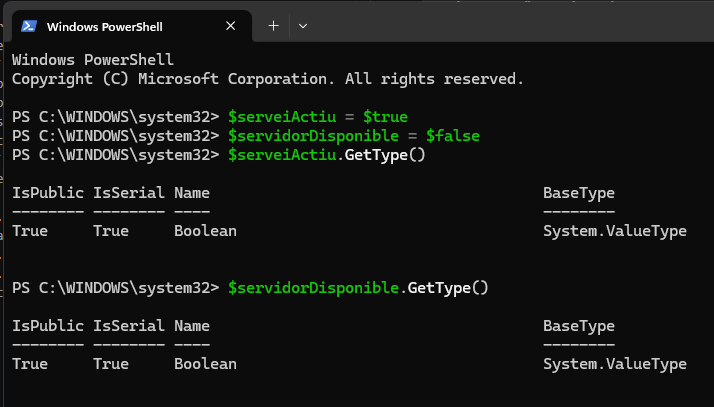
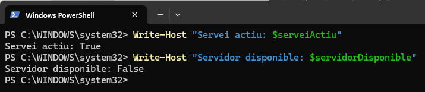
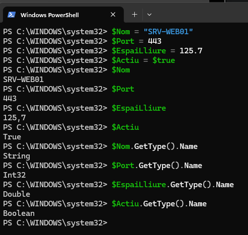

> **Nota**: Els exercicis/pràctiques t'han de servir per a familiarizar-te amb el llenguatge Powershell. Aprofita per a realitzar diverses proves i veure què passa. Documenta també aquestes proves i resultats.

# Tipus de dades

## 1. Identificar tipus

Crea les variables següents:

```powershell
$nom = "Servidor01"
$port = 443
$actiu = $true
$espai = 12.5
```

Consulta el tipus de cadascuna amb:

```powershell
.GetType()
```



## 2. Número o text?

Executa:

```powershell
$a = 10
$b = 5

$a + $b
```

Després:

```powershell
$a = "10"
$b = "5"

$a + $b
```

Respon:

- Quin resultat obtens en cada cas?



- Per què no és el mateix?

Perquè si posem el número dins d'unes ("") passa a ser un String i deixa de ser un Int per això no suma en el segon resultat sinó que l'afegeix.

Mostra després el contingut de cadascuna de les variables.



- Quin tipus tenen $a i $b en cada cas?

Les dues variables tenen el tipus String l'últim tipus que ha aconseguit.

## 3. Canviar el tipus d'una variable

Executa:

```powershell
$valor = 100
```

Consulta:

```powershell
$valor.GetType()
```

Ara executa:

```powershell
$valor = "100"
```

i torna a consultar:

```powershell
$valor.GetType()
```

Respon:

**Ha canviat el valor? Ha canviat el tipus?**

No ha canviat de valor pero si de tipus.



## 4. Tipus explícits

Executa:

```powershell
[int]$port = 443
```

Comprova el tipus:

```powershell
$port.GetType()
```

Ara prova:

```
[string]$portText = 443
```

Consulta també:

```powershell
$portText.GetType()
```

Respon:

**Tot i que visualment els dos valors semblen `443`, són del mateix tipus?**

No son el mateix tipus



## 5. Booleans

Crea:

```powershell
$serveiActiu = $true
$servidorDisponible = $false
```

Consulta els tipus.



Després mostra un missatge amb:

```
Write-Host "Servei actiu: $serveiActiu"
Write-Host "Servidor disponible: $servidorDisponible"
```



## 6. General

Crea variables per representar un servidor amb aquesta informació:

```
Nom: SRV-WEB01
Port: 443
Espai lliure: 125.7 GB
Actiu: True
```

Després:

1. mostra el valor de totes les variables;
2. consulta el tipus de cadascuna;
3. indica quin tipus de dada has utilitzat per cada valor.



**Conclusió**: PowerShell assigna automàticament el tipus de dada segons el valor que guardem a cada variable. Per exemple, les cometes indiquen text, els nombres sense cometes són numèrics i $true representa un valor lògic.