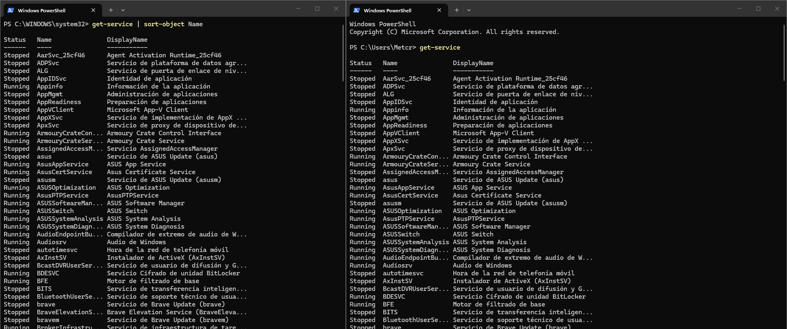
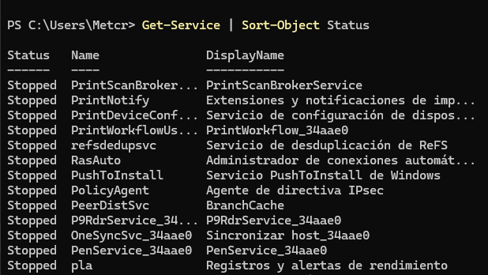
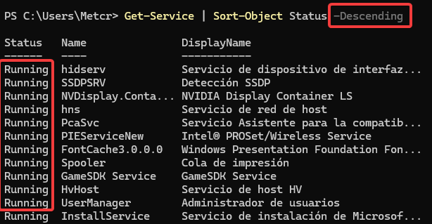
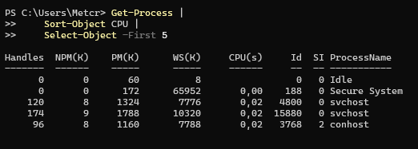

> **Nota:** Els exercicis i pràctiques t'han de servir per familiaritzar-te amb el llenguatge PowerShell. Aprofita per fer diverses proves i observar què passa. **Documenta també les proves que facis i els resultats obtinguts.**

# Pipeline

## 1. Primer pipeline

Executa:

```powershell
Get-Service
```

Ara executa:

```powershell
Get-Service | Sort-Object Name
```



Respon:

1. Quina diferència observes entre les dues sortides?

Cap diferencia, ja que tambe esta ordenat x nom predeterminadament.

El símbol | (pipeline) envia els resultats de la primera ordre a la segona, perquè aquesta els pugui processar.

2. Què fa la part situada abans de `|`?

Obte la llista de serveis.


3. Què fa la part situada després de `|`?

Ordena els serveis pel nom.

4. `Sort-Object` crea els serveis o rep serveis creats per una altra ordre?

Rep els serveis del Get-Service.

5. Quina ordre és la que genera inicialment les dades?

El Get-Service.

Fes ara la prova:

```powershell
Get-Service | Sort-Object Status
```



Què ha canviat?

Ara esta ordenat per l'estat del servei.

Finalment:

```powershell
Get-Service | Sort-Object Status -Descending
```



Explica amb les teves paraules què ha fet el pipeline.

Ha obtingut els serveis els ha ordenat per l'estat i de manera descendent primer els serveis actius després els que estan inactius.

---

## 2. El mateix problema sense pipeline

Executa:

```powershell
$serveis = Get-Service
```

Ara:

```powershell
$serveis
```

I després:

```powershell
$serveis | Sort-Object Name
```

Compara-ho amb:

```powershell
Get-Service | Sort-Object Name
```

Respon:

1. Obtenen el mateix resultat?

Sí obtens el mateix resultat

2. Quina diferència hi ha entre les dues formes de treballar?

Que amb el get-service en una variable és molt més llegible i entenedor a l'hora de fer molts filtres amb les |

3. En quin cas s'ha guardat prèviament la informació en una variable?

En aquest cas :

$serveis | Sort-Object Name


Crea ara:

```powershell
$serveisOrdenats = Get-Service | Sort-Object Name
```

Mostra:

```powershell
$serveisOrdenats
```

Explica què conté aquesta variable.

Aquesta variable conte els serveis ordenats pel nom.

---

## 3. Construir un pipeline pas a pas

Executa primer:

```powershell
Get-Process
```

Ara:

```powershell
Get-Process | Sort-Object CPU
```

Finalment:

```powershell
Get-Process |
    Sort-Object CPU |
    Select-Object -First 5
```



No continuïs fins haver observat el resultat de cada ordre.

Completa:

| Pas | Ordre | Què entra? | Què surt? |
|---|---|---|---|
| 1 | `Get-Process` | obte procesos| una llista de procesos|
| 2 | `Sort-Object CPU` | ordena els procesos per consum de CPU | llista dels procesos de a menys consum a mes consum de CPU  |
| 3 | `Select-Object -First 5` | filtra els 5 primers procesos| els 5 procesos ambmenys CPU utilitzada|

Explica què passaria si eliminéssim:

```powershell
Sort-Object CPU
```

del pipeline.

Comprova-ho executant:

```powershell
Get-Process | Select-Object -First 5
```

Els cinc processos obtinguts són necessàriament els que consumeixen més CPU?

Clarament, no només ens mostra els 5 primers en l'orde predeterminat.

Explica per què.

Perquè no hem filtrat per CPU.
---

## 4. Ordenar processos

Emmagatzema en una variable tots els processos que s'estan executant ordenats de **major a menor consum de CPU**.

Mostra després el contingut de la variable.

A partir de la variable anterior:

1. mostra els tres primers processos;
2. mostra els cinc primers;
3. mostra els deu primers.

No tornis a executar `Get-Process` per fer aquests tres apartats.

---

## 5. Canviar l'ordre del pipeline

Executa:

```powershell
Get-Process |
    Sort-Object CPU -Descending |
    Select-Object -First 5
```

Ara executa:

```powershell
Get-Process |
    Select-Object -First 5 |
    Sort-Object CPU -Descending
```

Respon:

1. Les dues ordres fan el mateix?
2. Per què?
3. Quants processos arriben a `Sort-Object` en el primer cas?
4. Quants processos arriben a `Sort-Object` en el segon?

Aquest exercici és important: **l'ordre dels cmdlets dins del pipeline modifica el resultat**.

---

## 6. Fitxers i carpetes

Executa:

```powershell
Get-ChildItem
```

Ara ordena el resultat pel nom.

Després ordena'l segons la seva mida.

> Pista: observa les dades que mostra `Get-ChildItem`.

Mostra per pantalla els dos elements més grans.

Després:

1. mostra els tres elements més petits;
2. mostra els cinc elements més grans;
3. guarda aquests cinc elements en una variable.

Comprova el contingut de la variable.

---

## 7. Modificar progressivament una ordre

Parteix de:

```powershell
Get-ChildItem
```

Transforma-la progressivament fins aconseguir:

```text
Mostrar només els tres elements més grans.
```

Documenta cada pas.

Per exemple:

```text
Pas 1 → obtenir elements
Pas 2 → ...
Pas 3 → ...
```

No escriguis directament l'ordre final.

L'objectiu és construir el pipeline **una operació cada vegada**.

---

## 8. Arrays

Crea:

```powershell
$servidors = "SRV04", "SRV01", "SRV03", "SRV02"
```

Mostra primer:

```powershell
$servidors
```

Ara:

```powershell
$servidors | Sort-Object
```

Respon:

1. Què està enviant `$servidors` al pipeline?
2. Quants elements passen pel pipeline?
3. `Sort-Object` modifica la variable original?

Comprova-ho tornant a executar:

```powershell
$servidors
```

Ara ordena els servidors en ordre invers.

---

## 9. Ports

Crea:

```powershell
$ports = 443, 22, 8080, 80, 3389
```

Mostra:

1. els ports tal com estan emmagatzemats;
2. els ports ordenats de menor a major;
3. els ports ordenats de major a menor;
4. els dos ports més petits;
5. els dos ports més grans.

En cada cas, utilitza `$ports` com a origen del pipeline.

---

## 10. Comptar elements

Executa:

```powershell
Get-Process | Measure-Object
```

Localitza:

```text
Count
```

Compara ara:

```powershell
$processos = Get-Process
$processos.Count
```

amb:

```powershell
Get-Process | Measure-Object
```

Respon:

1. Què està comptant cada cas?
2. Quin resultat obtens?
3. Quina diferència observes en la sortida?

Fes el mateix amb:

```powershell
Get-Service
```

