# `Select-Object` i `Where-Object`

> **Nota:** Els exercicis t'han de servir per familiaritzar-te amb PowerShell. No et limitis a executar les ordres: fes proves, modifica valors i propietats i observa què passa. Documenta les proves que consideris rellevants.
## 1. Investigar els objectes

Executa:
```
Get-Process
```
Observa la informació que mostra PowerShell.

Ara investiga un procés amb:

```
Get-Process |
    Select-Object -First 1 |
    Select-Object *
```
i:
```
Get-Process |
    Get-Member
```
Respon:

1. `Get-Process` mostra inicialment totes les propietats de l'objecte?

No mostra totes les propietats d'un objecte, per consultar totes les propietats podem utilitzar Select-Object *. 

2. Quina diferència hi ha entre `Select-Object *` i `Get-Member`?

Select-Object * mostra els valors de totes les propietats d'un objecte, mentre que Get-Member permet consultar els membres que té l'objecte, com ara les propietats i els mètodes.

3. Localitza almenys tres propietats que no coneixies. 

    
Utilitza després `Select-Object` per mostrar únicament tres propietats que consideris útils.

Handles: nombre de identificadors de recursos oberts pel procés.

WorkingSet64: quantitat de memòria física (RAM) que utilitza el procés, en bytes.

Responding: indica si el procés respon.

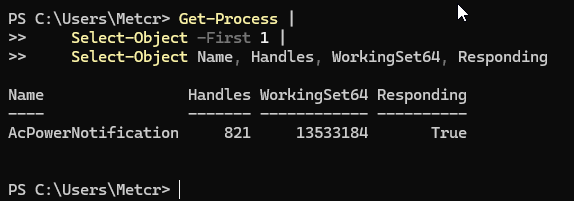

## 2. Seleccionar propietats i objectes

Amb `Get-Process`, construeix ordres que permetin:

1. mostrar només `Name` i `CPU`;

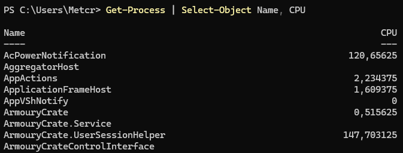

2. mostrar només `Name`, `Id` i `CPU`;

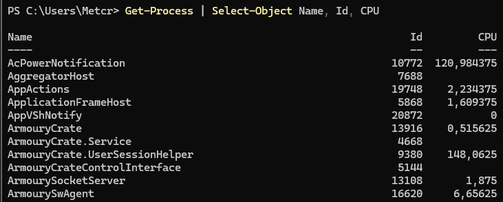

3. mostrar només els cinc primers processos;
    
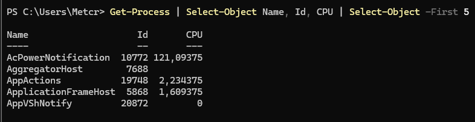

4. mostrar només els tres últims processos.
    
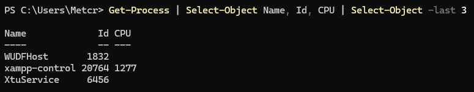

Respon:

**Quina diferència hi ha entre seleccionar propietats i seleccionar objectes?**

Seleccionar propietats significa escollir quina informació volem mostrar d'un objecte, per exemple Name, Id o CPU.

En canvi, seleccionar objectes significa escollir quins elements volem obtenir d'una llista, per exemple els cinc primers processos o els tres últims.

Per seleccionar propietats utilitzem els noms de les propietats amb Select-Object, mentre que per seleccionar objectes podem utilitzar paràmetres com -First i -Last.


## 3. Ordenar i seleccionar

Construeix un pipeline que mostri els **cinc processos amb més CPU**.

La sortida ha de mostrar únicament:

```
Name
Id
CPU
```

Compara després aquestes dues estratègies:

```
ordenar → seleccionar 5
```

i:

```
seleccionar 5 → ordenar
```

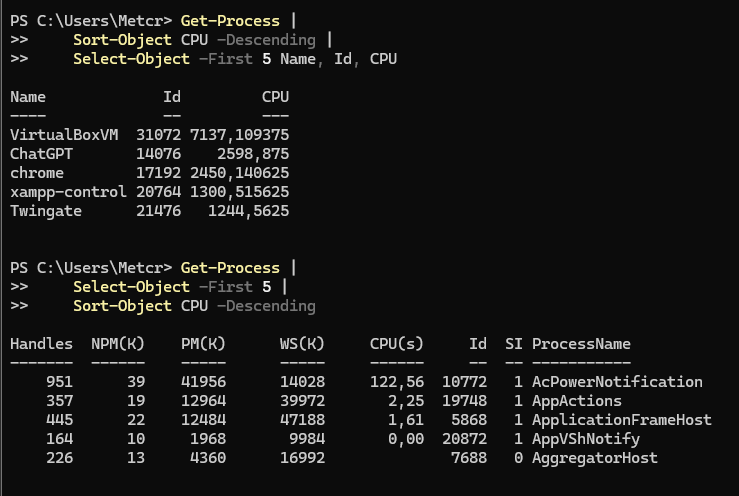

Respon:

1. Fan el mateix?
    
No, les dues ordres no fan el mateix. La primera obté els cinc processos amb més CPU de tot el sistema, mentre que la segona només ordena els cinc primers processos obtinguts inicialment.

2. Per què?

Perquè l'ordre de les operacions del pipeline és important. Si ordenem abans de seleccionar, comparem tots els processos. En canvi, si seleccionem primer, només ordenem els cinc processos seleccionats inicialment.
    
3. Quants processos rep `Sort-Object` en cada cas?

En la primera estratègia, Sort-Object rep tots els processos obtinguts per Get-Process.

En la segona estratègia, Sort-Object només rep cinc processos, perquè Select-Object -First 5 ja ha limitat els objectes.
    
## 4. Primer filtre

Crea:

```
$numeros = 5, 20, 3, 40, 12, 8, 30
```

Utilitzant `Where-Object`, mostra (adjunta comandes):


1. els números superiors a `10`;

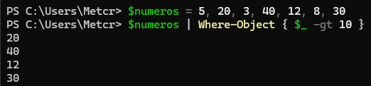
    
2. els números inferiors a `20`;

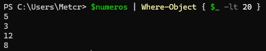
    
3. els números iguals a `12`;

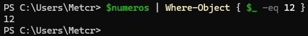
    
4. tots els números diferents de `20`.

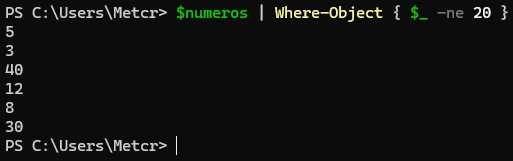
    
Per cada cas identifica quin operador has utilitzat:

| Operador PowerShell | Símbol matemàtic | Significat |
|---|---|---|
| `-gt` | `>` | Major que |
| `-lt` | `<` | Menor que |
| `-eq` | `==` | Igual |
| `-ne` | `!=` | Diferent |
| `-ge` | `>=` | Major o igual |
| `-le` | `<=` | Menor o igual |


## 5. Entendre `$_`

Utilitza:

```
$numeros = 5, 20, 3
```

i analitza:

```
$numeros |
    Where-Object { $_ -gt 10 }
```

Completa:

|Valor de `$_`|Resultat de `$_ -gt 10`|Passa el filtre?|
|---|---|---|
|5|False|NO|
|20|True|SÍ|
|3|False|NO|

Explica amb les teves paraules:

**Què representa** `$_`**?**

$_ és una variable automàtica de PowerShell que representa l'element actual que està processant el pipeline. En aquest cas, representa cada número de la llista que s'està comprovant amb Where-Object.

## 6. Filtrar objectes per propietats

Executa:

```
Get-Service
```

Construeix un pipeline que mostri únicament els serveis que estan en execució.

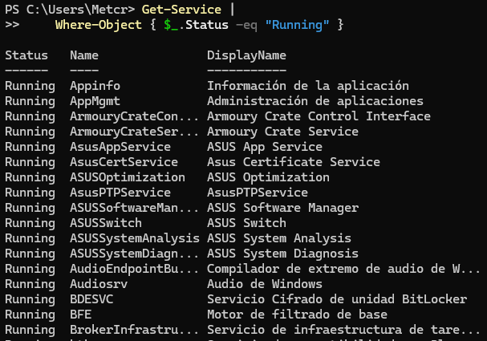

La sortida final ha de mostrar només:

```
Name
Status
```

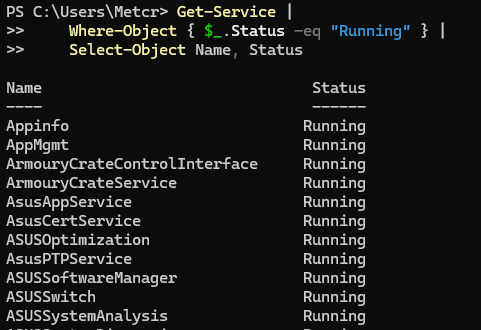

Després construeix-ne un altre que mostri els serveis que **no** estan en execució.

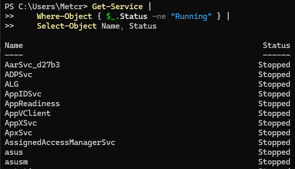

Respon:

1. Què representa `$_`?

Representa l'objecte actual que està processant el pipeline. En aquest cas, representa cada servei de Windows que s'està examinant.
    
2. Què representa `$_.Status`?

Representa la propietat Status de l'objecte actual, que indica l'estat en què es troba el servei, com ara Running o Stopped.
    
3. Què fa `Where-Object` amb els objectes que no compleixen la condició?

Els descarta del resultat i només deixa passar els objectes que compleixen la condició establerta.
    
4. Què fa després `Select-Object`?

Selecciona les propietats que volem mostrar dels objectes que han superat el filtre. En aquest cas, Name i Status.


## 7. Combinar condicions

Crea:

```
$numeros = 1, 5, 10, 15, 20, 25, 30, 40
```

Construeix filtres que mostrin:

1. números entre `10` i `30` ambdós inclosos;

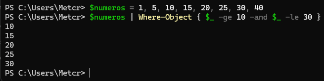
    
2. números inferiors a `10` o superiors a `30`.

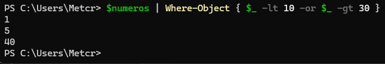

## 8. Pipeline complet

Construeix progressivament un pipeline que:

1. obtingui tots els processos;

Get-Process
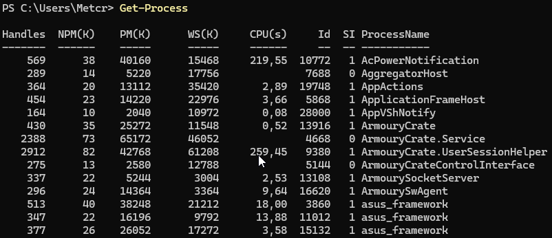
    
2. deixi només els processos amb `CPU > 5`;

Get-Process |
    Where-Object { $_.CPU -gt 5 }
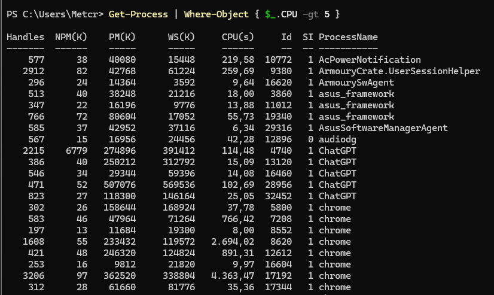
    
3. deixi, a més, només els processos amb `Id > 1000`;

Get-Process |
    Where-Object { $_.CPU -gt 5 -and $_.Id -gt 1000 } 
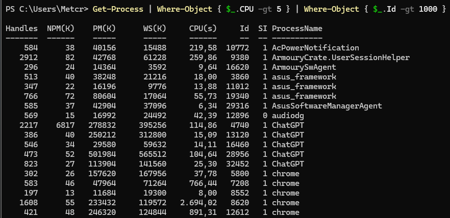

4. els ordeni de major a menor CPU;

Get-Process |
    Where-Object { $_.CPU -gt 5 -and $_.Id -gt 1000 } | Sort-Object CPU -Descending
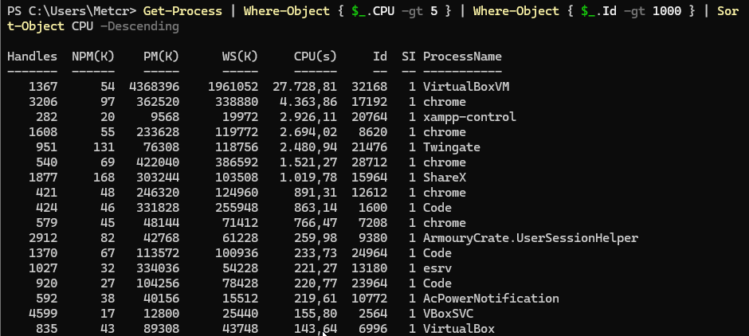
    
5. mostri només els cinc primers;

Select-Object -First 5
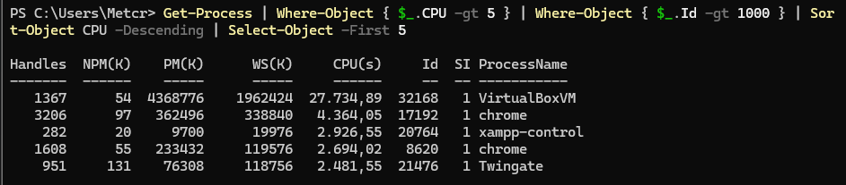

6. mostri només les propietats:
```
Name
Id
CPU
```
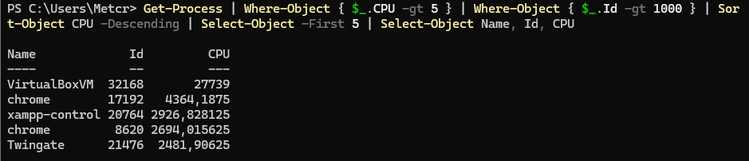

No intentis escriure directament tota l'ordre.

Executa-la després d'afegir cada nova etapa i observa com va canviant el resultat.

Representa finalment el recorregut:

```
Get-Process
     ↓
Where-Object { $_.CPU -gt 5 }
     ↓
Where-Object { $_.Id -gt 1000 }
     ↓
Sort-Object CPU -Descending
     ↓
Select-Object -First 5
     ↓
Select-Object Name, Id, CPU
```

Indica què entra i què surt de cada etapa.

## 9. Detectar errors de raonament

Un alumne vol obtenir els cinc processos amb més CPU:

```
Get-Process |
    Select-Object -First 5 |
    Sort-Object CPU -Descending
```

L'ordre funciona.

**Resol correctament el problema? Justifica la resposta i corregeix-la.**

El problema és l'ordre de les operacions.

Primer seleccionem cinc processos qualsevols i després els ordenem. Per tant, no tenim cap garantia que siguin els cinc processos que més CPU consumeixen de tot l'ordinador.

```
Get-Process |
    Sort-Object CPU -Descending |
    Select-Object -First 5
```
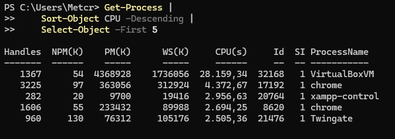


# 10. Conclusions

Explica amb les teves paraules:

1. Per a què serveix `Select-Object`?
    
2. Quina diferència hi ha entre seleccionar **objectes** i seleccionar **propietats**?
    
3. Quina diferència hi ha entre `Get-Member` i `Select-Object *`?
      
4. Per a què serveix `Where-Object`?
    
5. Què representa `$_`? I `$_.CPU`?
    
6. Què passa amb un objecte quan la condició de `Where-Object` retorna `True`? I quan retorna `False`?
     
7. Explica què entra, què surt i què fa cadascuna de les etapes:
```
Get-Process |
    Where-Object {
        $_.CPU -gt 10 -and $_.Id -gt 1000
    } |
    Sort-Object CPU -Descending |
    Select-Object -First 5 Name, Id, CPU
```
11. Es podria millorar l'ordre anterior fent alguna operació en un altre moment del pipeline? Justifica la resposta.
