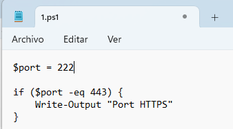
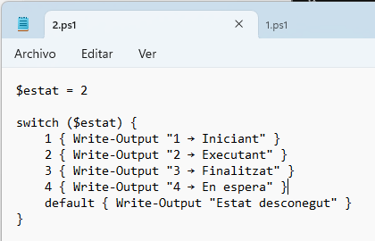
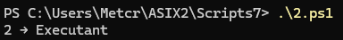
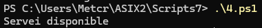

# Pràctica

## 1. Condicional

Crea:
```powershell
$port = 443
```
Mostra:
```
Port HTTPS
```
si el port és `443`.

Canvia després el valor de `$port` i comprova què passa.





## 2. if o switch

Crea:
```
$estat = 2
```
Fes que el programa mostri:
```
1 → Iniciant
2 → Executant
3 → Finalitzat
4 → En espera
qualsevol altre valor → Estat desconegut
```





Resol el problema utilitzant `if` i `switch`. Compara les dues solucions. 

Amb switch és molt més senzill. Amb if és més manual, més llarg i menys entenedor.

## 4. Condicions combinades

Crea:

```powershell
$port = 443
$actiu = $true
```
Mostra:

```text
Servei disponible
```

només quan el port sigui el 443 i estigui actiu

if ($port -eq 443 -and $actiu -eq $true){write-output "Servei disponible"}




