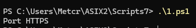
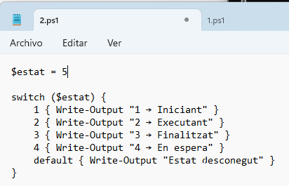
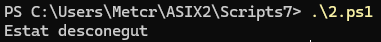
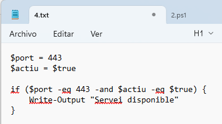
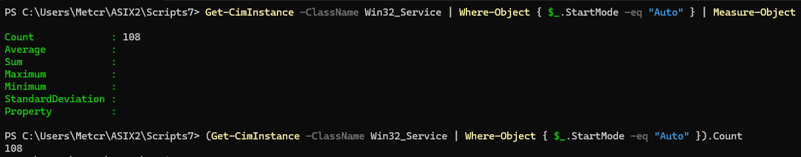

# Pràctica

## 1. Condicional

Crea:
```powershell
$port = 443
```
Mostra:
```
Port HTTPS
```
si el port és `443`.

Canvia després el valor de `$port` i comprova què passa.





## 2. if o switch

Crea:
```
$estat = 2
```
Fes que el programa mostri:
```
1 → Iniciant
2 → Executant
3 → Finalitzat
4 → En espera
qualsevol altre valor → Estat desconegut
```






Resol el problema utilitzant `if` i `switch`. Compara les dues solucions. 

Amb switch és molt més senzill. Amb if és més manual, més llarg i menys entenedor.

## 4. Condicions combinades

Crea:

```powershell
$port = 443
$actiu = $true
```
Mostra:

```text
Servei disponible
```

només quan el port sigui el 443 i estigui actiu

if ($port -eq 443 -and $actiu -eq $true){write-output "Servei disponible"}




## 7. Objectes

Quants serveis en el teu sistema estan configurats amb el servei d'arrencada automàtic quan s'inicia l'equip? 

Proposa diferents codis de resolució.



# Conclusions

Explica amb les teves paraules:

1. Què representa la variable `$servei` en:
```powershell
$serveis = Get-Service
foreach ($servei in $serveis) {
    ...
}
```
**La variable $servei representa tots els serveis que conte la comanta Get-Service la cual obte tots els serveis.**

2. Quina diferència hi ha entre `foreach` i `ForEach-Object`?

**El foreach recorre el que conté una variable d'un en un.**

**El ForEach-Object també va d'un en un, pero no recorre una variable sino que processa els objectes que rep pel pipeline**

3. Què representa `$_` dins de `ForEach-Object`?

**Representa l'objecte actual que s'està processant en aquell moment.**
